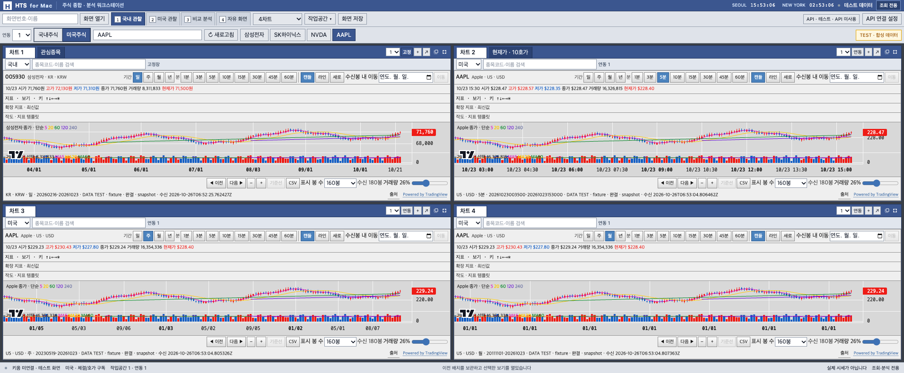

# HTS for Mac

**윈도우 HTS처럼 쓰는 맥용 주식 조회·분석 화면입니다.**

국내·미국주식의 시세·호가·차트·관심종목을 한 화면에 모아 봅니다. 컴퓨터에 설치해 실행한 뒤 브라우저에서 사용하는 방식이며, 지원되는 조회 기능을 쓰기 위해 Windows나 Parallels를 실행할 필요가 없습니다.

**조회·분석 전용입니다. 매수·매도·정정·취소·자동매매·환전·이체·개인 계좌 조회는 제공하지 않습니다. 키움증권 공식 제품이나 제휴 서비스가 아닙니다.**



[약 79초 기능 시연 영상(MP4, 약 4.5MB)](docs/media/hts-for-mac-demo.mp4) · [한국어 자막(VTT)](docs/media/hts-for-mac-demo.ko.vtt) · [최신 릴리스](https://github.com/duct-tape2/hts-for-mac/releases)

영상과 위 이미지는 실제 앱을 **합성 테스트 데이터**로 조작한 모습입니다. 실시간 시세나 투자 성과를 보여주는 영상이 아닙니다. 소리가 없는 영상이며, GitHub 파일 화면에서 재생되지 않으면 View raw로 내려받아 재생하세요.

## 왜 만들었나요?

맥을 주로 쓰면서도 주식 정보를 보려면 Windows 컴퓨터로 옮겨가거나 가상환경을 켜야 하는 점이 번거로웠습니다. 자주 사용하는 조회 기능을 맥에서 이용할 수 있도록 기존 공개 프로젝트를 확장했습니다. 주문 기능을 늘리기보다 종목을 찾고, 차트를 비교하고, 내 화면 구성을 저장하는 흐름에 집중했습니다.

## 이런 분께 맞습니다

- 맥에서 국내·미국주식의 시세와 차트를 확인하고 싶은 분
- 여러 주기나 종목의 차트를 나란히 놓고 비교하는 분
- 매매는 별도 증권사 앱에서 하고, 조회·분석 작업공간을 따로 두고 싶은 분

영웅문 전체 기능이나 공식 HTS와 동일한 동작을 보장하는 제품은 아닙니다. 현재는 소스 설치형 사전 출시 버전입니다.

## 주요 기능

| 기능 | 할 수 있는 일 |
|---|---|
| 종목 조회 | 국내·미국 종목 검색, 현재가·호가·시장 체결 확인. 원화·달러 구분 |
| 차트와 비교 | 4차트 배치, 분·일·주·월·년봉, 보조지표·작도, 최대 4종목 상대 등락률 비교 |
| 나만의 작업공간 | 관심종목 그룹, 4개 작업공간, 창 분리·종목 연동·고정, 배치 저장·복원 |
| 분석 화면 | 국내 순위·수급, 프로그램·ETF·테마 조회, 저장 조건검색, 관심종목 필터·알림·메모 |
| 인증 관리 | macOS Keychain 키 보관, 접속 토큰 자동 갱신, 입력한 API 등록 만료일 7일 전 재발급 안내 |

차트에는 **TradingView Lightweight Charts 라이브러리**를 사용합니다. 이 라이브러리가 시세를 제공하는 것은 아닙니다. 키움 시세는 본인의 키움 REST API로 연결하며, 공시·뉴스 등 일부 정보는 별도 공급원을 사용합니다. 개별 기능의 제한은 아래에 적었습니다.

## 실제 시세 연결 전 준비

1. 본인 명의 키움 계좌를 준비합니다. 계좌가 없다면 키움의 공식 계좌 개설 절차를 먼저 진행합니다.
2. [키움 REST API 공식 이용안내](https://openapi.kiwoom.com/intro/serviceInfo)에 따라 사용 신청, 허용 IP 등록, 계좌 등록·인증을 진행합니다.
3. 실제 투자 환경의 App Key와 App Secret을 발급받습니다. 모의 환경 키와 구분하세요.
4. 아래 절차로 앱을 설치하고 실제 시세 모드로 실행한 뒤, 로컬 화면의 API 연결 설정에서 키와 등록 만료일을 입력합니다. 키를 GitHub 이슈·댓글·채팅에 올리지 마세요.

키움 계좌만 있다고 바로 연결되는 것은 아닙니다. 먼저 API 사용 등록과 키 발급을 마쳐야 합니다. 키 없이 화면을 살펴보려면 합성 데이터 모드로 시작할 수 있습니다.

## 설치와 실행

macOS, Git, [uv](https://docs.astral.sh/uv/), npm과 Node.js(22.13 이상의 22.x, 24.x, 26 이상 중 하나. 23.x·25.x는 지원하지 않음)가 필요합니다. 실행기는 PATH의 python3로 실행되고, 백엔드용 Python 3.13은 uv가 준비합니다.

```bash
git clone https://github.com/duct-tape2/hts-for-mac.git
cd hts-for-mac
./scripts/setup.sh
./dev.sh
```

[http://127.0.0.1:3010](http://127.0.0.1:3010)을 엽니다. 첫 실행은 **합성 테스트 데이터(fixture)** 이며 API 키가 필요 없습니다. 새 브라우저에서는 관심종목·순위·차트·시황·뉴스 등 13개 화면으로 된 「13종 · 순위」 배치로 시작합니다. 기존 저장 배치는 보존됩니다.

실제 시세를 보려면 테스트 실행을 Ctrl+C로 종료하고 다음을 실행합니다.

```bash
npm --prefix frontend run build
python3 scripts/run_local.py --environment real
```

화면의 **API 연결 설정**에서 본인의 키움 App Key·App Secret과 발급 화면의 등록 만료일을 입력합니다. 만료일은 사용자마다 직접 입력하며 특정 날짜로 고정하지 않습니다. 접속 토큰은 자동 갱신하지만 API 등록 자체가 만료되면 본인이 재발급한 키와 새 날짜를 입력해야 합니다. API 서버와 화면 서버는 실행기가 함께 띄우며 Ctrl+C로 둘 다 종료합니다. 브라우저 탭은 직접 닫습니다.

실행 중 코드 변경을 반영할 때는 다른 터미널에서 `python3 scripts/run_local.py --reload`를 실행합니다. 이 명령은 새 서버를 띄우지 않고 실행 중인 실행기에 다시 읽기 신호만 보냅니다. 개발 모드는 `./dev.sh --environment real`입니다. 포트 3010/8010이 사용 중이면 다른 프로세스를 강제 종료하지 않고 실행을 중단합니다.

키와 개인 설정을 Git에 올리지 마세요. `.env`는 자동으로 읽지 않습니다. 로컬 127.0.0.1 전용이며 인터넷 서버로 열어 사용하는 구조가 아닙니다.

## 화면 사용

상단 화면번호·이름으로 기능을 열고, 같은 연동 번호의 창끼리 종목을 공유합니다. 종목 고정은 그 창만 유지합니다. ＋는 창 복제, ↗는 별도 창 분리입니다. 탭·경계선을 끌어 배치를 바꾸고 작업공간 메뉴에서 내보내기/가져오기를 사용합니다.

`Home`: 화면검색 · `Ctrl+1~4`: 작업공간 전환 · 관심종목 방향키: 종목 이동 · 차트 `←`/`→`: 이동, `↑`/`+`: 확대, `↓`/`-`: 축소, `*`: 전체 보기.

다른 Mac으로 옮기는 방법은 [설치·이전 안내](docs/hts/MAC-MOVE.md)를 참고하세요. 배치·메모·작도는 사용자가 직접 내보내며 API 키는 새 Mac에서 다시 등록합니다.

## 데이터 범위와 알려진 제한

실시간·스냅샷·미수신·오류와 일부 조회를 구분합니다. 실제 조회가 실패해도 합성 가격으로 대체하지 않습니다. 원시 거래시각의 날짜·시간대가 확인되지 않으면 거래소 봉으로 추정하지 않습니다. 비교차트는 환율을 적용한 투자수익률이 아니라 수신 종가의 상대변화입니다.

국내 일반 종목 연결은 KRX 기준입니다. 거래소 구분을 지원하는 일부 국내 조회(순위·수급, 프로그램 매매, 테마, ETF 전체시세 등)에서 KRX/NXT/통합 필터를 제공합니다. 조건검색은 키움에 이미 저장된 조건을 조회하며, 앱 자체 필터는 관심종목의 확보된 데이터만 평가합니다. 알림은 지원 브라우저와 열린 앱·수신 연결이 있어야 작동합니다.

공시·재무는 별도 공급원을 사용합니다. DART는 본인 OpenDART 키, SEC는 실제 연락처가 포함된 User-Agent를 설정해야 합니다. 미설정이면 안내를 표시하며 키움 시세는 계속 사용할 수 있습니다. 뉴스는 RSS 제목·제공 요약·원문 링크를 표시합니다. 시장종합 화면의 해외지수·환율·원자재는 Yahoo Finance 공개 차트 피드를 사용하며 지연될 수 있습니다. 공개로 접근할 수 있다는 사실이 상업적 재사용 허락을 뜻하지는 않습니다.

현재 확인된 키움 거절: 시간외 단일가 호가/순위(ka10087·ka10098, 오류 1504), 미국 관심종목 통합 조회(화면명 '미국주식 시가대비 등락률 상위(관심종목)', usa20922, 오류 1517). 해당 화면은 오류를 명시합니다. 다른 조회 기능의 성공을 이 세 기능의 성공으로 해석하지 않습니다.

이 릴리스는 소스 설치용 사전 출시 버전입니다. 서명된 독립 macOS 앱/Tauri 패키지, 영웅문 전체 기능 동일성, 다른 Mac 물리 설치, 6시간 부하·장중 같은 시점 대조를 완료했다고 주장하지 않습니다. 세부 검증 결과는 릴리스 노트를 확인하세요.

## 개발 검증

저장소 루트에서 CI와 같은 명령으로 확인합니다.

```bash
uv run --project backend --extra test pytest backend/tests tests
npm --prefix frontend test
npm --prefix frontend run typecheck
npm --prefix frontend run build
```

원본·사용 라이브러리·데이터 공급자의 권리는 [NOTICE](NOTICE.md)와 [의존성 고지](docs/hts/OPEN-SOURCE.md)에 정리했습니다. 저장소 공개를 모든 포함 코드에 대한 일괄 오픈소스 라이선스 부여로 해석하지 않습니다.

## 확인한 범위

v0.23.0-rc.2 기준으로 Python 360개·프런트엔드 296개, 총 656개 테스트와 타입 검사·빌드·CI가 통과했습니다. 릴리스 검증 과정에서 실제 키로 삼성전자·SK하이닉스·AAPL의 핵심 시세·호가·차트 수신과 다중 종목 연결을 확인했습니다. v0.23.0-rc.2까지는 Moa Desk라는 이름으로 배포했습니다. 이는 해당 릴리스의 검증 기록이며, 모든 기능이나 모든 맥에서의 동작을 보장하는 수치는 아닙니다.

[RC2 검증 결과](https://github.com/duct-tape2/hts-for-mac/releases/tag/v0.23.0-rc.2) · [해당 커밋 CI](https://github.com/duct-tape2/hts-for-mac/actions/runs/40252345421)

## 기반 프로젝트와 출처

[chicago007/kiwoom_mac_trading](https://github.com/chicago007/kiwoom_mac_trading)을 기반으로, 원저작자에게 수정본 공개 배포를 허락받았다는 배포자 확인에 따라 확장했습니다. 기존 화면·React/Next.js·FastAPI 기반을 활용하고 국내주식 조회, 다중 종목 연결, 분석 작업공간과 인증 관리를 보강했습니다. 기반 프로젝트는 `kiwoom_autotrading`을 기반으로 한다고 명시합니다.

- [TradingView Lightweight Charts](https://github.com/tradingview/lightweight-charts): 차트 렌더링
- [FlexLayout](https://github.com/caplin/FlexLayout): 창 배치
- [키움 공식 SDK](https://github.com/Kiwoom-Securities/Kiwoom-REST-API): API 연결. 공식 배포 패키지로 설치하며 소스는 이 저장소에 포함하지 않습니다. 일반적인 자유 이용 오픈소스 라이선스와 조건이 다릅니다.

원본 코드, 라이브러리, 시세·공시·기사의 권리는 각 권리자에게 있습니다. 저장소 공개가 일괄적인 상용 이용 허락이나 SDK 재배포 허락을 뜻하지 않습니다. 자세한 조건은 [NOTICE](NOTICE.md)와 [의존성 고지](docs/hts/OPEN-SOURCE.md)를 확인하세요.

## 사용 의견

설치나 화면 사용 중 문제가 생기면 OS·앱 버전, 재현 순서, 민감정보를 가린 화면을 GitHub 이슈로 남겨주세요. API 키·토큰·계좌정보는 첨부하지 마세요. 필요한 도구였다면 Star로 표시해 주셔도 좋습니다.
